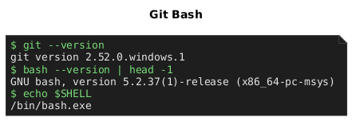
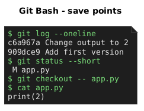
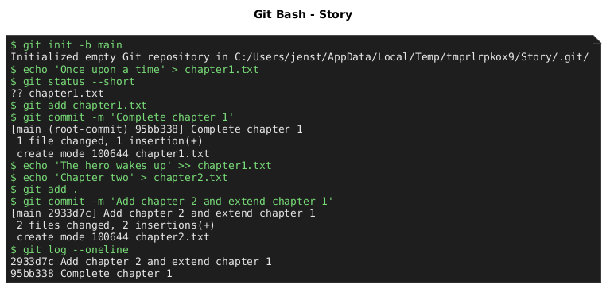
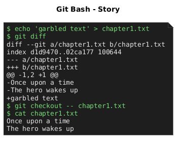
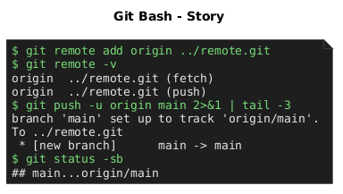
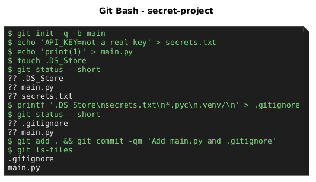
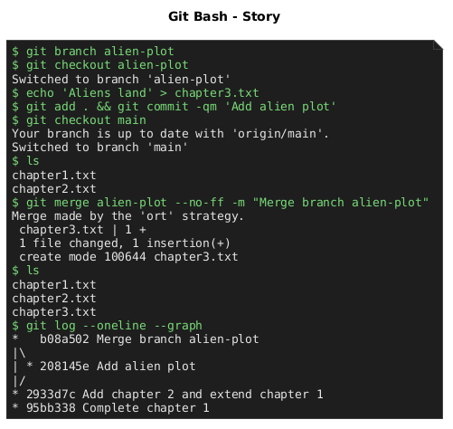
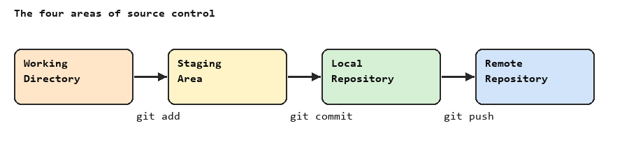
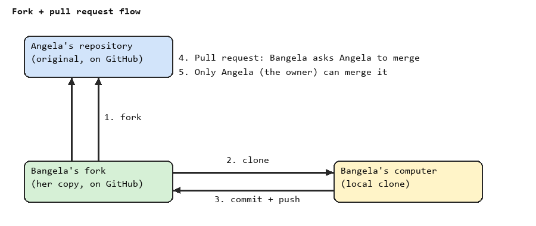

# 🚀 Day 70: Version Control with Git and GitHub

Notes for Day 70 of Udemy's *100 Days of Code: The Complete Python Pro Bootcamp*:
installing Git Bash, saving versions locally, pushing to GitHub, ignoring secrets,
branching and merging, and forking with pull requests. For course participants and
GitHub visitors; there is no code to run and no runtime dependency.

## 📚 Table of Contents

- [Overview](#-overview)
- [Lecture steps](#-lecture-steps)
- [Requirements](#-requirements)
- [Setup](#-setup)
- [Run](#-run)
- [Tests](#-tests)
- [License](#-license)
- [Links](#-links)
- [Appendix: Project documents](#-appendix-project-documents)

## 🧭 Overview

Day 70 has no programming assignment; it is a hands-on lecture about version control.
This repository therefore holds documentation only:

- `README.md` - this file, a short walk through each lecture step.
- Wiki - what each step taught, in [English][wiki-en], [Danish][wiki-da] and
  [Bahasa Melayu][wiki-ms].
- `docs/images/` - one screenshot per lecture step.
- `src/` and `tests/` - not used on this day (no programming).

The screenshots are PlantUML diagrams (sources in `docs/diagrams/`, rendered to
`docs/images/`). The terminal ones show the output of real `git` commands run in a
throwaway repository (the "Story" example from the lecture); the others are
sequence and flow diagrams. They are not frames from the course video, which is the
instructor's copyrighted material.

## 🪜 Lecture steps

### 1. Install Git and Git Bash (Windows)

Download Git for Windows, keep the defaults, keep **Git Bash** ticked, then pick
*Git Bash* as the default terminal profile in VS Code. Mac users can skip this step.



### 2. What is version control?

A version is a save point of your code. If you break something, you compare with an
earlier save point and roll back.



### 3. Local version control

`git init`, `git status`, `git add`, `git commit -m "..."` (present tense), `git log`,
`git diff` and `git checkout -- <file>`.




### 4. GitHub and remote repositories

Create an empty repository on the host, then `git remote add origin <url>` and
`git push -u origin main`. The screenshot pushes to a local bare repository so it runs
offline; against GitHub only the URL differs.



### 5. `.gitignore`

List the files Git must never commit (secrets, `.DS_Store`, caches) in `.gitignore`
*before* the first commit. Python templates: <https://github.com/github/gitignore>.



### 6. Branching and merging

`git branch`, `git checkout`, then `git merge` the experimental branch (`alien-plot`)
back into `main`. Practice more at <https://learngitbranching.js.org/>.



### 7. Forking and pull requests

The four areas of source control, then fork, clone, push and open a pull request; only
the owner of the original repository merges it.




Sources: [four-areas.puml](docs/diagrams/four-areas.puml) and [fork-pull-request.puml](docs/diagrams/fork-pull-request.puml).

## 📋 Requirements

- [Git][git-download] (on Windows, Git for Windows with Git Bash) - to repeat the
  commands in the lecture.
- Python 3.10 or newer - only for the optional virtual environment below.

## 🛠️ Setup

Create and use a local virtual environment named `.venv` (it is ignored by Git):

```bash
# Windows (Git Bash)
python -m venv .venv
source .venv/Scripts/activate
python -m pip install --upgrade pip
```

```bash
# macOS / Linux
python3 -m venv .venv
source .venv/bin/activate
python -m pip install --upgrade pip
```

Leave the environment with `deactivate`. This project has no packages to install.

## ▶️ Run

Not applicable: there is no program. Read this file and the wiki.

## 🧪 Tests

Not applicable: no code on this day.

## 📄 License

GPL, see [LICENSE](./LICENSE).

## 🔗 Links

- [Repository][repository]
- [Wiki (English)][wiki-en] · [Wiki (Dansk)][wiki-da] · [Wiki (Bahasa Malaysia)][wiki-ms]
- [Issue tracker][issues]

## 📎 Appendix: Project documents

| Document | What it tells you |
| --- | --- |
| [AGENTS.md][agents] | The rules AI agents follow in this repository |
| [Artifact registry][registry] | Where each artifact type lives |
| [Framework README][framework-readme] | The framework this project uses |
| [Framework changelog][framework-changelog] | What changed in each framework release |

---

[repository]: https://git.tirsystem.com/Tirsvad-Udemy-100-days-of-code/070-version-control
[wiki-en]: https://git.tirsystem.com/Tirsvad-Udemy-100-days-of-code/070-version-control/wiki/Home
[wiki-da]: https://git.tirsystem.com/Tirsvad-Udemy-100-days-of-code/070-version-control/wiki/Home-da
[wiki-ms]: https://git.tirsystem.com/Tirsvad-Udemy-100-days-of-code/070-version-control/wiki/Home-ms
[issues]: https://git.tirsystem.com/Tirsvad-Udemy-100-days-of-code/070-version-control/issues
[git-download]: https://git-scm.com/downloads
[agents]: ./AGENTS.md
[registry]: ./docs/artifact-registry.md
[framework-readme]: ./framework/README.md
[framework-changelog]: ./framework/CHANGELOG.md
