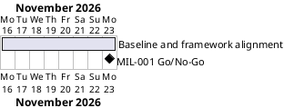

# Project Plan: Version Control

## Metadata
| Key | Value |
| --- | --- |
| ID | PP-001 |
| CrossReference | [BC-001], [SA-001], [MIL-001] |
| Language | en |
| Domain | education |

## Version History
| Date | Status | Author | Reviewer | Change | Commit |
| --- | --- | --- | --- | --- | --- |
| 2026-11-16 | Accepted | Jens Tirsvad Nielsen | AI as stand-in for S02 | Initial version; accepted with the Go verdict of the review record (autonomous, not independent) | pending |

---

## Purpose

This plan schedules the one gateway of the baseline project, [MIL-001], between 2026-11-16 and 2026-11-23, the one-week constraint of the Business Case ([BC-001]).

## Planning Assumptions

- Week 1 starts 2026-11-16; the plan ends by 2026-11-23, per the Business Case constraint (source: [BC-001], Constraints).
- Phase length: one week, because the work is documentation, a wiki and metadata for finished study notes (source: [BC-001], Scope).
- The owner and the reviewer are S01 and S02 from [SA-001]; they are the same person, so the review is done by a stand-in (source: [SA-001], Conflicting Interests).
- The baseline is the agreed minimum quality baseline: no change to the notes, no use cases and no design artifacts (source: [BC-001], Out of Scope).

## Gateway Schedule

| Gateway | Document | Window | Decision date | Owner | Stories | Main deliverable | Milestone |
| --- | --- | --- | --- | --- | --- | --- | --- |
| Baseline and framework alignment | [MIL-001] | 2026-11-16 to 2026-11-23 | 2026-11-23 | S01 | none (documentation and technical tasks) | The accepted baseline documents and traceability matrix, the wiki in three languages, the Project Documents wiki pages, the README with the licence stated and the adopted framework release | [Milestone 591][milestone-591] |



## Scope Coverage

| Business Case scope item | Gateway |
| --- | --- |
| Adopting the framework release | [MIL-001] |
| The baseline documents and their review records | [MIL-001] |
| The Project Documents wiki page in English, Danish and Malay | [MIL-001] |
| The README restored to the template | [MIL-001] |
| The licence stated in the README | [MIL-001] |

## Dependencies

```
MIL-001 (no predecessor)
```

A No-Go on [MIL-001] moves the end date: S01 decides the new date; no later gateway is planned that the move could affect.

## Plan Risks

| Risk | Impact | Mitigation |
| --- | --- | --- |
| A CI (continuous integration) check fails on the pull request | The merge is delayed past 2026-11-23 | The failure is fixed on the same branch and the checks run again; after three failed rounds on one cause the run stops and S01 decides (trace: Business Case risk on the wiki publication and on drift) |
| A review gives No-Go | The decision date moves | The document is fixed and reviewed again; S01 decides a new date |

## Open Issues

- The lecture notes are not reviewed against a checklist (the framework has none for study notes); a later milestone would plan that review. The diagrams are the author's own PlantUML drawings of real `git` output in a throwaway repository.
- The published wiki is checked on the git host after the merge, because the host copies it only then.

---

[BC-001]: ./business-case.md
[SA-001]: ./stakeholder-analysis.md
[MIL-001]: ./milestones/mil-001-baseline.md
[milestone-591]: https://git.tirsystem.com/Tirsvad-Udemy-100-days-of-code/070-version-control/milestone/591
