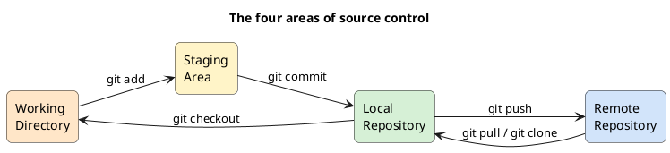
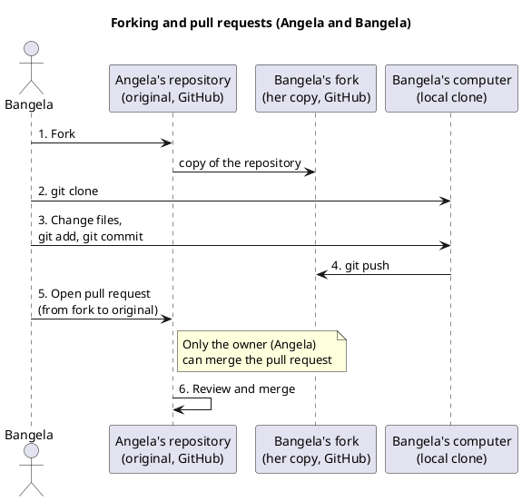

[English](Lecture-Steps) · **Dansk** · [Bahasa Melayu](Lecture-Steps-ms)

# Forelæsningstrin

## 1. Installer Git og Git Bash

**Hvad vi gjorde:** Hentede Git til Windows, accepterede licensen, beholdt standardvalgene (Git Bash afkrydset) og satte Git Bash som standardprofil i terminalen i VS Code. Mac-brugere springer over: Bash er allerede installeret.

```plantuml
@startuml 01-install-git
skinparam shadowing false
skinparam note {
  BackgroundColor #1E1E1E
  BorderColor #3C3C3C
}
title Git Bash
note as N
<font:monospaced><color:#78DC78><U+0024><U+00A0>git<U+00A0><U+002D><U+002D>version</color></font>
<font:monospaced><color:#E6E6E6>git<U+00A0>version<U+00A0>2<U+002E>52<U+002E>0<U+002E>windows<U+002E>1</color></font>
<font:monospaced><color:#78DC78><U+0024><U+00A0>bash<U+00A0><U+002D><U+002D>version<U+00A0><U+007C><U+00A0>head<U+00A0><U+002D>1</color></font>
<font:monospaced><color:#E6E6E6>GNU<U+00A0>bash<U+002C><U+00A0>version<U+00A0>5<U+002E>2<U+002E>37<U+0028>1<U+0029><U+002D>release<U+00A0><U+0028>x86<U+005F>64<U+002D>pc<U+002D>msys<U+0029></color></font>
<font:monospaced><color:#78DC78><U+0024><U+00A0>echo<U+00A0><U+0024>SHELL</color></font>
<font:monospaced><color:#E6E6E6><U+002F>bin<U+002F>bash<U+002E>exe</color></font>
end note
@enduml
```

**Hvad vi lærte:** En fungerende `git`-kommando og en Unix-lignende shell på Windows, så alle senere kommandoer i kurset virker ens på alle systemer.

## 2. Hvad er versionsstyring?

**Hvad vi gjorde:** Versionsstyring gemmer versioner (gemmepunkter) af dine filer. Hvis kode går i stykker, sammenligner du med en tidligere version og ruller tilbage. Git understøtter også kloning, forking, pull requests og sammenfletning.

```plantuml
@startuml 02-version-control
skinparam shadowing false
skinparam note {
  BackgroundColor #1E1E1E
  BorderColor #3C3C3C
}
title Git Bash - save points
note as N
<font:monospaced><color:#78DC78><U+0024><U+00A0>git<U+00A0>log<U+00A0><U+002D><U+002D>oneline</color></font>
<font:monospaced><color:#E6E6E6>c6a967a<U+00A0>Change<U+00A0>output<U+00A0>to<U+00A0>2</color></font>
<font:monospaced><color:#E6E6E6>909dce9<U+00A0>Add<U+00A0>first<U+00A0>version</color></font>
<font:monospaced><color:#78DC78><U+0024><U+00A0>git<U+00A0>status<U+00A0><U+002D><U+002D>short</color></font>
<font:monospaced><color:#E6E6E6><U+00A0>M<U+00A0>app<U+002E>py</color></font>
<font:monospaced><color:#78DC78><U+0024><U+00A0>git<U+00A0>checkout<U+00A0><U+002D><U+002D><U+00A0>app<U+002E>py</color></font>
<font:monospaced><color:#78DC78><U+0024><U+00A0>cat<U+00A0>app<U+002E>py</color></font>
<font:monospaced><color:#E6E6E6>print<U+0028>2<U+0029></color></font>
end note
@enduml
```

**Hvad vi lærte:** Forståelsen af, at intet går tabt: hver ændring er et trin, der kan gendannes, så det er trygt at eksperimentere.

## 3. Lokal versionsstyring

```plantuml
@startuml 03-local-git
skinparam shadowing false
skinparam note {
  BackgroundColor #1E1E1E
  BorderColor #3C3C3C
}
title Git Bash - Story
note as N
<font:monospaced><color:#78DC78><U+0024><U+00A0>git<U+00A0>init<U+00A0><U+002D>b<U+00A0>main</color></font>
<font:monospaced><color:#E6E6E6>Initialized<U+00A0>empty<U+00A0>Git<U+00A0>repository<U+00A0>in<U+00A0>C<U+003A><U+002F>Users<U+002F>jenst<U+002F>AppData<U+002F>Local<U+002F>Temp<U+002F>tmprlrpkox9<U+002F>Story<U+002F><U+002E>git<U+002F></color></font>
<font:monospaced><color:#78DC78><U+0024><U+00A0>echo<U+00A0><U+0027>Once<U+00A0>upon<U+00A0>a<U+00A0>time<U+0027><U+00A0><U+003E><U+00A0>chapter1<U+002E>txt</color></font>
<font:monospaced><color:#78DC78><U+0024><U+00A0>git<U+00A0>status<U+00A0><U+002D><U+002D>short</color></font>
<font:monospaced><color:#E6E6E6><U+003F><U+003F><U+00A0>chapter1<U+002E>txt</color></font>
<font:monospaced><color:#78DC78><U+0024><U+00A0>git<U+00A0>add<U+00A0>chapter1<U+002E>txt</color></font>
<font:monospaced><color:#78DC78><U+0024><U+00A0>git<U+00A0>commit<U+00A0><U+002D>m<U+00A0><U+0027>Complete<U+00A0>chapter<U+00A0>1<U+0027></color></font>
<font:monospaced><color:#E6E6E6><U+005B>main<U+00A0><U+0028>root<U+002D>commit<U+0029><U+00A0>95bb338<U+005D><U+00A0>Complete<U+00A0>chapter<U+00A0>1</color></font>
<font:monospaced><color:#E6E6E6><U+00A0>1<U+00A0>file<U+00A0>changed<U+002C><U+00A0>1<U+00A0>insertion<U+0028><U+002B><U+0029></color></font>
<font:monospaced><color:#E6E6E6><U+00A0>create<U+00A0>mode<U+00A0>100644<U+00A0>chapter1<U+002E>txt</color></font>
<font:monospaced><color:#78DC78><U+0024><U+00A0>echo<U+00A0><U+0027>The<U+00A0>hero<U+00A0>wakes<U+00A0>up<U+0027><U+00A0><U+003E><U+003E><U+00A0>chapter1<U+002E>txt</color></font>
<font:monospaced><color:#78DC78><U+0024><U+00A0>echo<U+00A0><U+0027>Chapter<U+00A0>two<U+0027><U+00A0><U+003E><U+00A0>chapter2<U+002E>txt</color></font>
<font:monospaced><color:#78DC78><U+0024><U+00A0>git<U+00A0>add<U+00A0><U+002E></color></font>
<font:monospaced><color:#78DC78><U+0024><U+00A0>git<U+00A0>commit<U+00A0><U+002D>m<U+00A0><U+0027>Add<U+00A0>chapter<U+00A0>2<U+00A0>and<U+00A0>extend<U+00A0>chapter<U+00A0>1<U+0027></color></font>
<font:monospaced><color:#E6E6E6><U+005B>main<U+00A0>2933d7c<U+005D><U+00A0>Add<U+00A0>chapter<U+00A0>2<U+00A0>and<U+00A0>extend<U+00A0>chapter<U+00A0>1</color></font>
<font:monospaced><color:#E6E6E6><U+00A0>2<U+00A0>files<U+00A0>changed<U+002C><U+00A0>2<U+00A0>insertions<U+0028><U+002B><U+0029></color></font>
<font:monospaced><color:#E6E6E6><U+00A0>create<U+00A0>mode<U+00A0>100644<U+00A0>chapter2<U+002E>txt</color></font>
<font:monospaced><color:#78DC78><U+0024><U+00A0>git<U+00A0>log<U+00A0><U+002D><U+002D>oneline</color></font>
<font:monospaced><color:#E6E6E6>2933d7c<U+00A0>Add<U+00A0>chapter<U+00A0>2<U+00A0>and<U+00A0>extend<U+00A0>chapter<U+00A0>1</color></font>
<font:monospaced><color:#E6E6E6>95bb338<U+00A0>Complete<U+00A0>chapter<U+00A0>1</color></font>
end note
@enduml
```

```plantuml
@startuml 03b-diff-restore
skinparam shadowing false
skinparam note {
  BackgroundColor #1E1E1E
  BorderColor #3C3C3C
}
title Git Bash - Story
note as N
<font:monospaced><color:#78DC78><U+0024><U+00A0>echo<U+00A0><U+0027>garbled<U+00A0>text<U+0027><U+00A0><U+003E><U+00A0>chapter1<U+002E>txt</color></font>
<font:monospaced><color:#78DC78><U+0024><U+00A0>git<U+00A0>diff</color></font>
<font:monospaced><color:#E6E6E6>diff<U+00A0><U+002D><U+002D>git<U+00A0>a<U+002F>chapter1<U+002E>txt<U+00A0>b<U+002F>chapter1<U+002E>txt</color></font>
<font:monospaced><color:#E6E6E6>index<U+00A0>d1d9470<U+002E><U+002E>02ca177<U+00A0>100644</color></font>
<font:monospaced><color:#E6E6E6><U+002D><U+002D><U+002D><U+00A0>a<U+002F>chapter1<U+002E>txt</color></font>
<font:monospaced><color:#E6E6E6><U+002B><U+002B><U+002B><U+00A0>b<U+002F>chapter1<U+002E>txt</color></font>
<font:monospaced><color:#E6E6E6><U+0040><U+0040><U+00A0><U+002D>1<U+002C>2<U+00A0><U+002B>1<U+00A0><U+0040><U+0040></color></font>
<font:monospaced><color:#E6E6E6><U+002D>Once<U+00A0>upon<U+00A0>a<U+00A0>time</color></font>
<font:monospaced><color:#E6E6E6><U+002D>The<U+00A0>hero<U+00A0>wakes<U+00A0>up</color></font>
<font:monospaced><color:#E6E6E6><U+002B>garbled<U+00A0>text</color></font>
<font:monospaced><color:#78DC78><U+0024><U+00A0>git<U+00A0>checkout<U+00A0><U+002D><U+002D><U+00A0>chapter1<U+002E>txt</color></font>
<font:monospaced><color:#78DC78><U+0024><U+00A0>cat<U+00A0>chapter1<U+002E>txt</color></font>
<font:monospaced><color:#E6E6E6>Once<U+00A0>upon<U+00A0>a<U+00A0>time</color></font>
<font:monospaced><color:#E6E6E6>The<U+00A0>hero<U+00A0>wakes<U+00A0>up</color></font>
end note
@enduml
```

**Hvad vi gjorde:** I en mappe `Story` kørte vi `git init`, oprettede `chapter1.txt`, tilføjede den til staging med `git add`, gemte med `git commit -m "Complete chapter 1"` (nutid), så historikken med `git log`, sammenlignede med `git diff` og gendannede en fil med `git checkout -- <fil>`.

**Hvad vi lærte:** Forskellen på arbejdsmappen og staging-området, hvordan man laver en commit, læser historikken og fortryder uønskede ændringer.

## 4. GitHub og eksterne repositories

```plantuml
@startuml 04-remote-push
skinparam shadowing false
skinparam note {
  BackgroundColor #1E1E1E
  BorderColor #3C3C3C
}
title Git Bash - Story
note as N
<font:monospaced><color:#78DC78><U+0024><U+00A0>git<U+00A0>remote<U+00A0>add<U+00A0>origin<U+00A0><U+002E><U+002E><U+002F>remote<U+002E>git</color></font>
<font:monospaced><color:#78DC78><U+0024><U+00A0>git<U+00A0>remote<U+00A0><U+002D>v</color></font>
<font:monospaced><color:#E6E6E6>origin<U+0009><U+002E><U+002E><U+002F>remote<U+002E>git<U+00A0><U+0028>fetch<U+0029></color></font>
<font:monospaced><color:#E6E6E6>origin<U+0009><U+002E><U+002E><U+002F>remote<U+002E>git<U+00A0><U+0028>push<U+0029></color></font>
<font:monospaced><color:#78DC78><U+0024><U+00A0>git<U+00A0>push<U+00A0><U+002D>u<U+00A0>origin<U+00A0>main<U+00A0>2<U+003E><U+0026>1<U+00A0><U+007C><U+00A0>tail<U+00A0><U+002D>3</color></font>
<font:monospaced><color:#E6E6E6>branch<U+00A0><U+0027>main<U+0027><U+00A0>set<U+00A0>up<U+00A0>to<U+00A0>track<U+00A0><U+0027>origin<U+002F>main<U+0027><U+002E></color></font>
<font:monospaced><color:#E6E6E6>To<U+00A0><U+002E><U+002E><U+002F>remote<U+002E>git</color></font>
<font:monospaced><color:#E6E6E6><U+00A0><U+002A><U+00A0><U+005B>new<U+00A0>branch<U+005D><U+00A0><U+00A0><U+00A0><U+00A0><U+00A0><U+00A0>main<U+00A0><U+002D><U+003E><U+00A0>main</color></font>
<font:monospaced><color:#78DC78><U+0024><U+00A0>git<U+00A0>status<U+00A0><U+002D>sb</color></font>
<font:monospaced><color:#E6E6E6><U+0023><U+0023><U+00A0>main<U+002E><U+002E><U+002E>origin<U+002F>main</color></font>
end note
@enduml
```

**Hvad vi gjorde:** Oprettede en GitHub-konto og et tomt repository (offentligt eller privat), forbandt det lokale repository med `git remote add origin <url>` og uploadede med `git push -u origin main`. Skærmbilledet pusher til et lokalt bare-repository, så det virker offline.

**Hvad vi lærte:** En ekstern kopi som backup og til deling, samt betydningen af `origin` og `main`-grenen.

## 5. Filen .gitignore

**Hvad vi gjorde:** Oprettede `.gitignore` før første commit og skrev `secrets.txt`, `.DS_Store`, `*.pyc` og `.venv/` ind. Git holder så op med at vise filerne og committer dem aldrig. Skabeloner pr. sprog: github.com/github/gitignore.

```plantuml
@startuml 05-gitignore
skinparam shadowing false
skinparam note {
  BackgroundColor #1E1E1E
  BorderColor #3C3C3C
}
title Git Bash - secret-project
note as N
<font:monospaced><color:#78DC78><U+0024><U+00A0>git<U+00A0>init<U+00A0><U+002D>q<U+00A0><U+002D>b<U+00A0>main</color></font>
<font:monospaced><color:#78DC78><U+0024><U+00A0>echo<U+00A0><U+0027>API<U+005F>KEY<U+003D>not<U+002D>a<U+002D>real<U+002D>key<U+0027><U+00A0><U+003E><U+00A0>secrets<U+002E>txt</color></font>
<font:monospaced><color:#78DC78><U+0024><U+00A0>echo<U+00A0><U+0027>print<U+0028>1<U+0029><U+0027><U+00A0><U+003E><U+00A0>main<U+002E>py</color></font>
<font:monospaced><color:#78DC78><U+0024><U+00A0>touch<U+00A0><U+002E>DS<U+005F>Store</color></font>
<font:monospaced><color:#78DC78><U+0024><U+00A0>git<U+00A0>status<U+00A0><U+002D><U+002D>short</color></font>
<font:monospaced><color:#E6E6E6><U+003F><U+003F><U+00A0><U+002E>DS<U+005F>Store</color></font>
<font:monospaced><color:#E6E6E6><U+003F><U+003F><U+00A0>main<U+002E>py</color></font>
<font:monospaced><color:#E6E6E6><U+003F><U+003F><U+00A0>secrets<U+002E>txt</color></font>
<font:monospaced><color:#78DC78><U+0024><U+00A0>printf<U+00A0><U+0027><U+002E>DS<U+005F>Store<U+005C>nsecrets<U+002E>txt<U+005C>n<U+002A><U+002E>pyc<U+005C>n<U+002E>venv<U+002F><U+005C>n<U+0027><U+00A0><U+003E><U+00A0><U+002E>gitignore</color></font>
<font:monospaced><color:#78DC78><U+0024><U+00A0>git<U+00A0>status<U+00A0><U+002D><U+002D>short</color></font>
<font:monospaced><color:#E6E6E6><U+003F><U+003F><U+00A0><U+002E>gitignore</color></font>
<font:monospaced><color:#E6E6E6><U+003F><U+003F><U+00A0>main<U+002E>py</color></font>
<font:monospaced><color:#78DC78><U+0024><U+00A0>git<U+00A0>add<U+00A0><U+002E><U+00A0><U+0026><U+0026><U+00A0>git<U+00A0>commit<U+00A0><U+002D>qm<U+00A0><U+0027>Add<U+00A0>main<U+002E>py<U+00A0>and<U+00A0><U+002E>gitignore<U+0027></color></font>
<font:monospaced><color:#78DC78><U+0024><U+00A0>git<U+00A0>ls<U+002D>files</color></font>
<font:monospaced><color:#E6E6E6><U+002E>gitignore</color></font>
<font:monospaced><color:#E6E6E6>main<U+002E>py</color></font>
end note
@enduml
```

**Hvad vi lærte:** Hvordan man holder adgangskoder og API-nøgler ude af lokale og offentlige repositories, og at jokertegn og `#`-kommentarer virker i filen.

## 6. Grene og sammenfletning

**Hvad vi gjorde:** Oprettede grenen `alien-plot` med `git branch`, skiftede med `git checkout`, lavede commits dér, skiftede tilbage til `main` og samlede arbejdet med `git merge alien-plot`. Valgfri øvelse: learngitbranching.js.org.

```plantuml
@startuml 06-branching
skinparam shadowing false
skinparam note {
  BackgroundColor #1E1E1E
  BorderColor #3C3C3C
}
title Git Bash - Story
note as N
<font:monospaced><color:#78DC78><U+0024><U+00A0>git<U+00A0>branch<U+00A0>alien<U+002D>plot</color></font>
<font:monospaced><color:#78DC78><U+0024><U+00A0>git<U+00A0>checkout<U+00A0>alien<U+002D>plot</color></font>
<font:monospaced><color:#E6E6E6>Switched<U+00A0>to<U+00A0>branch<U+00A0><U+0027>alien<U+002D>plot<U+0027></color></font>
<font:monospaced><color:#78DC78><U+0024><U+00A0>echo<U+00A0><U+0027>Aliens<U+00A0>land<U+0027><U+00A0><U+003E><U+00A0>chapter3<U+002E>txt</color></font>
<font:monospaced><color:#78DC78><U+0024><U+00A0>git<U+00A0>add<U+00A0><U+002E><U+00A0><U+0026><U+0026><U+00A0>git<U+00A0>commit<U+00A0><U+002D>qm<U+00A0><U+0027>Add<U+00A0>alien<U+00A0>plot<U+0027></color></font>
<font:monospaced><color:#78DC78><U+0024><U+00A0>git<U+00A0>checkout<U+00A0>main</color></font>
<font:monospaced><color:#E6E6E6>Your<U+00A0>branch<U+00A0>is<U+00A0>up<U+00A0>to<U+00A0>date<U+00A0>with<U+00A0><U+0027>origin<U+002F>main<U+0027><U+002E></color></font>
<font:monospaced><color:#E6E6E6>Switched<U+00A0>to<U+00A0>branch<U+00A0><U+0027>main<U+0027></color></font>
<font:monospaced><color:#78DC78><U+0024><U+00A0>ls</color></font>
<font:monospaced><color:#E6E6E6>chapter1<U+002E>txt</color></font>
<font:monospaced><color:#E6E6E6>chapter2<U+002E>txt</color></font>
<font:monospaced><color:#78DC78><U+0024><U+00A0>git<U+00A0>merge<U+00A0>alien<U+002D>plot<U+00A0><U+002D><U+002D>no<U+002D>ff<U+00A0><U+002D>m<U+00A0><U+0022>Merge<U+00A0>branch<U+00A0>alien<U+002D>plot<U+0022></color></font>
<font:monospaced><color:#E6E6E6>Merge<U+00A0>made<U+00A0>by<U+00A0>the<U+00A0><U+0027>ort<U+0027><U+00A0>strategy<U+002E></color></font>
<font:monospaced><color:#E6E6E6><U+00A0>chapter3<U+002E>txt<U+00A0><U+007C><U+00A0>1<U+00A0><U+002B></color></font>
<font:monospaced><color:#E6E6E6><U+00A0>1<U+00A0>file<U+00A0>changed<U+002C><U+00A0>1<U+00A0>insertion<U+0028><U+002B><U+0029></color></font>
<font:monospaced><color:#E6E6E6><U+00A0>create<U+00A0>mode<U+00A0>100644<U+00A0>chapter3<U+002E>txt</color></font>
<font:monospaced><color:#78DC78><U+0024><U+00A0>ls</color></font>
<font:monospaced><color:#E6E6E6>chapter1<U+002E>txt</color></font>
<font:monospaced><color:#E6E6E6>chapter2<U+002E>txt</color></font>
<font:monospaced><color:#E6E6E6>chapter3<U+002E>txt</color></font>
<font:monospaced><color:#78DC78><U+0024><U+00A0>git<U+00A0>log<U+00A0><U+002D><U+002D>oneline<U+00A0><U+002D><U+002D>graph</color></font>
<font:monospaced><color:#E6E6E6><U+002A><U+00A0><U+00A0><U+00A0>b08a502<U+00A0>Merge<U+00A0>branch<U+00A0>alien<U+002D>plot</color></font>
<font:monospaced><color:#E6E6E6><U+007C><U+005C><U+00A0><U+00A0></color></font>
<font:monospaced><color:#E6E6E6><U+007C><U+00A0><U+002A><U+00A0>208145e<U+00A0>Add<U+00A0>alien<U+00A0>plot</color></font>
<font:monospaced><color:#E6E6E6><U+007C><U+002F><U+00A0><U+00A0></color></font>
<font:monospaced><color:#E6E6E6><U+002A><U+00A0>2933d7c<U+00A0>Add<U+00A0>chapter<U+00A0>2<U+00A0>and<U+00A0>extend<U+00A0>chapter<U+00A0>1</color></font>
<font:monospaced><color:#E6E6E6><U+002A><U+00A0>95bb338<U+00A0>Complete<U+00A0>chapter<U+00A0>1</color></font>
end note
@enduml
```

**Hvad vi lærte:** Eksperimenter og nye funktioner kan leve adskilt fra `main`, som forbliver stabil, og flettes først ind, når de virker.

## 7. Forking og pull requests

**Hvad vi gjorde:** Gennemgik de fire områder (arbejdsmappe, staging-område, lokalt repository, eksternt repository). En fork er din egen kopi af en andens repository; efter ændringer opretter du en pull request, hvor du beder ejeren om at flette. Kun ejeren kan flette.

**Hvad vi lærte:** Hvordan open source-samarbejde fungerer: foreslå ændringer uden at røre originalen, gennemse hinandens kode og bidrage til projekter.
